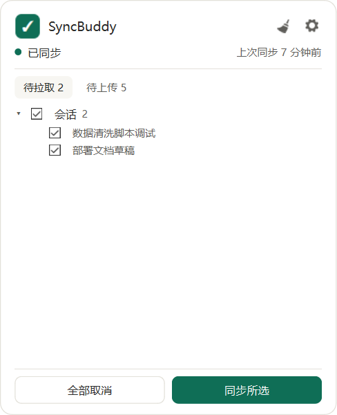
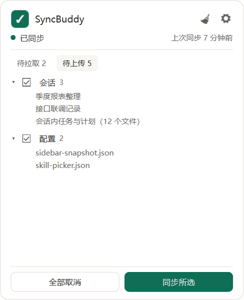
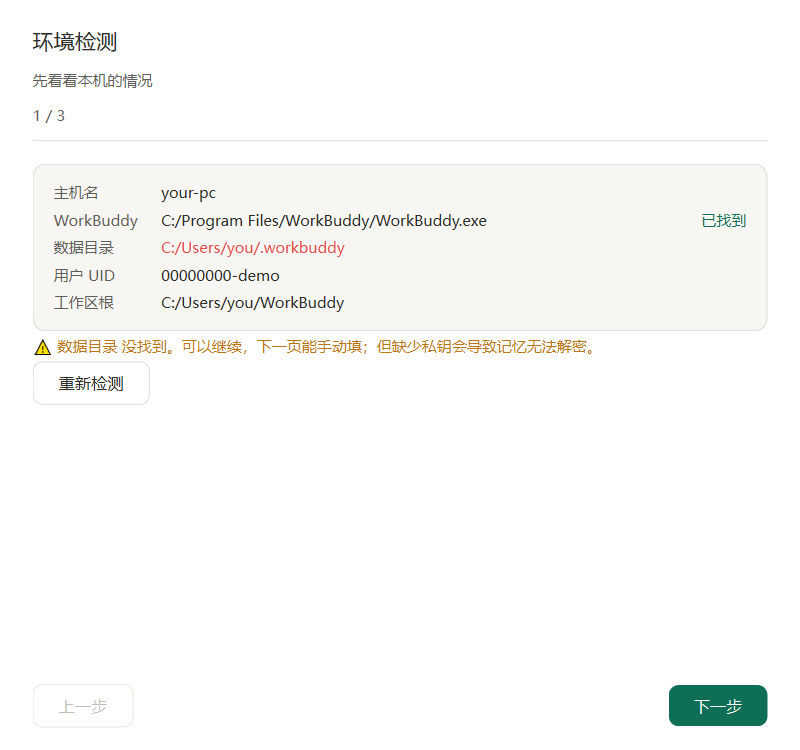
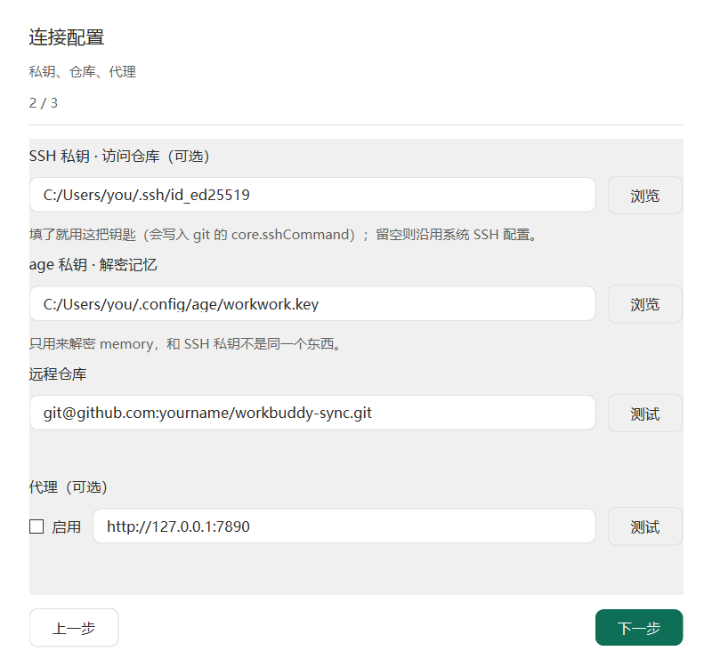

# SyncBuddy

当前版本 **v1.0.3**

WorkBuddy 的跨设备同步工具。关掉 WorkBuddy 时把改动推到私有 git 仓库，下次在另一台机器打开前再拉回来。

会话正文、任务列表、技能、记忆、配置都能带过去。双向的，两台机器都能推能拉。



## 起因

同时用两台机器干活之后发现，WorkBuddy 换机器就等于从头开始——之前聊到哪了、攒了什么技能、记忆里记过什么，全都不在。

翻了一遍 `app.asar`（用 `tools/asar_probe.py` 探的），情况是这样：

- 云端记忆有完整接口，`/api/memory/global/*`，确实是跨设备的
- 任务列表走 `/im/api/buddy/tasks` 中转，但会话正文的接口指向本机 sidecar
- 官方有个 `ExpertCloudSyncService`，双向同步，可惜只管专家包和企业技能

个人 skills 和会话正文没人管。所以自己搭了一个：拿 git 当传输层，会话正文和配置走明文，记忆用 age 加密。

## 同步范围

| 类别 | 具体内容 |
|---|---|
| 会话 | 索引 + 对话 jsonl + 会话内的任务清单和 plan 文档 |
| 身份与记忆 | `SOUL.md` / `IDENTITY.md` / `USER.md` / `MEMORY.md`，以及 `memory/`（age 加密） |
| 技能 | `skills/` 下的全部文件 |
| 配置 | mcp 配置、侧边栏快照、置顶状态、定时任务定义 |

刻意不传的：`device-id`、`epoch-marker`、`user-state.json`、`last-launch.json`、`*.db-wal`、`*.db-shm`。这些是设备绑定和运行时状态，同步过去会话会错乱。

## 目录结构

```
<你的目录>/
├── syncbuddy/      ← 这个项目
│   ├── syncbuddy.py        托盘主程序
│   ├── wbsync/             同步引擎
│   └── tools/              asar 探测
└── wb-sync/        ← 数据仓库（私有 git 仓库）
    ├── config.json         多机路径映射
    └── data/               实际同步的东西
```

代码和数据分开放。仓库里只有数据，工具通过 `WB_SYNC_REPO` 环境变量或者同级目录找到它。

## 上手

需要 Windows、Python 3.10+、git，以及 [age](https://github.com/FiloSottile/age)。

1. 建一个私有仓库，GitHub、Gitee、GitLab、自建 Gitea 都行。建的时候别勾 README 初始化，否则第一次推会撞上。
2. 克隆到 `syncbuddy` 旁边的 `wb-sync/`。
3. 双击 `SyncBuddy.vbs`。
4. 首次运行会弹配置向导，填三项：SSH 私钥（可留空）、age 私钥、远程仓库地址。

之后它就在托盘里待着。左键点开看状态，右键是菜单。

## 界面

**托盘面板**分两个页签。默认停在「待拉取」，因为换设备接续是主要场景。

左页是远端比本机多的会话，可以逐条取消——不想拉的那条留在远端，本机不写。右页是本机相对仓库的改动，按类别分组。



类别只有有内容的才显示，点标题能折叠。扫把图标清空历史，齿轮进设置。

**启动窗**分四步，能看出卡在哪一步：


`○` 没开始、`●` 进行中、`✓` 完成、`!` 出错、`–` 跳过。本地已经最新的时候，中间两步会标成跳过，不是留两个空心圈让你以为卡死。

**配置向导**三页：



第一页把本机情况列一遍，缺什么标红。第二页填两把钥匙——SSH 私钥管仓库访问，age 私钥管解密记忆，不是一回事，第一次用容易搞混。第三页选默认同步哪些类别。



配置过的机器重跑向导，两把钥匙会带回上次填的值。这里读的是 `config.json` 里自己存的东西，不扫磁盘找你机器上的私钥。

## 配置

`wb-sync/config.json` 是多机共享的路径映射表：

```json
{
  "hosts": {
    "第一台机器的主机名": {
      "workspace_root": "C:/Users/xxx/WorkBuddy",
      "workbuddy_home": "C:/Users/xxx/.workbuddy",
      "age_key_file": "...",
      "ssh_key_file": "..."
    },
    "第二台机器": { "...": "..." }
  }
}
```

导入时按 `workspace_root` 前缀重写路径，A 机器的绝对路径会变成 B 机器的。对不上的原样保留，同时打一条告警。

这里面没有密钥内容，只有路径。但有主机名和用户名，公开这份数据仓库之前自己看一眼。

字段说明见 [config.example.json](config.example.json)。

## 已知问题

**只在 Windows 上跑过。** 路径重写是按盘符写的，macOS 和 Linux 没测。

**仓库会一直变大。** 会话正文只增不减。现在 117MB，按日常使用强度算，半年可能到三五百兆。GitHub 单文件卡 100MB（目前最大 13MB），Gitee 免费版仓库 500MB 左右会先顶到。到时候要么换 GitLab，要么自建 Gitea。

**冲突按 UUID 合并，不是行级。** 同一段会话两端同时改，取 `updated_at` 晚的那个。

**从任务栏直接开 WorkBuddy 时，启动前同步来不及。** 数据库被锁着写不进去，只能等下次。

**预览里取消勾选的会话不写数据库，但文件还在仓库里。** 下次启动会再问你一次。

**依赖 WorkBuddy 的内部数据布局。** `workbuddy.db` 的表结构或者 `projects/*.jsonl` 的组织方式一变，就可能失效。

## 自检

```bash
python _selftest_gui.py       # 界面，8 项
python _selftest_wizard.py    # 向导，6 项
python wbsync/doctor.py       # 环境和仓库体检，15 项
python wbsync/test_remap.py   # 路径重写规则，8 项
```

## 文件说明

```
syncbuddy.py      托盘主程序、状态机
core.py           导出、导入、推送、状态收敛
gui.py            面板、启动窗、设置、历史
paths.py          仓库位置和远程主机的解析
setup_wizard.py   三页配置向导
preview.py        拉取前的差异预览
watch.py          WorkBuddy 进程监视
_proc.py          子进程封装（统一 CREATE_NO_WINDOW）
wizard.py         命令行版配置工具
wbsync/           同步引擎（export / import / doctor / test_remap）
tools/            asar_probe，探 WorkBuddy 主程序内部
icons/            SVG 图标
```

## 协议

Mozilla Public License 2.0，全文见 [LICENSE](LICENSE)。版权归 Veg0s。

